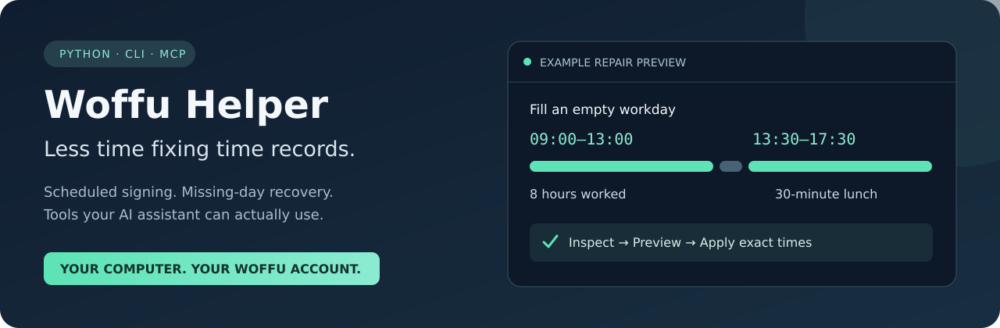

# Woffu Helper — time record automation and MCP server

[](https://github.com/jamessi1989/woffu-helper/actions/workflows/tests.yml)
[](LICENSE)
[](pyproject.toml)

**Fill missing Woffu workdays, fix forgotten clock-outs, and clock in and out on a schedule—from a terminal or a compatible AI assistant.**

Woffu Helper is an open-source Python CLI and local [Model Context Protocol (MCP)](https://modelcontextprotocol.io/) server for [Woffu](https://www.woffu.com/). It previews repairs, preserves existing clock-in/out records, and supports configurable work hours, lunch breaks, weekday schedules, and next-day recovery. Each person runs their own copy with their own Woffu account.



[Quick start](#quick-start) · [MCP setup](docs/MCP.md) · [CLI and scheduling guide](docs/USAGE.md) · [Español](README.es.md) · [Changelog](CHANGELOG.md)

## Choose how to use it

| You want to… | Use | What it does |
|---|---|---|
| Fill empty past workdays | `woffu-backfill fill` | Preview a schedule and submit it to eligible empty days. |
| Fix a forgotten clock-out | `woffu-backfill close` | Preserve recorded signs and add the missing final clock-out. |
| Clock in/out automatically | `woffu-autosign` + your scheduler | Follow your workweek, lunch and worked-hour target. |
| Recover after a missed run | Autosign recovery | Fill the most recent eligible empty workday and/or close unfinished days. |
| Ask an AI assistant to manage records | `woffu-mcp` | Inspect records, preview a repair, and optionally apply that exact preview. |

The tools use Woffu's internal web API. This is an independent community project, unaffiliated with Woffu; API changes can require updates. Use schedules that reflect work actually performed and your employer's recording policy.

## Quick start

### 1. Install

Python **3.9+** for the CLI; **3.10+** for MCP. These commands are for Linux/macOS; Windows uses `.venv\Scripts\python.exe` and `.venv\Scripts\Activate.ps1`.

```bash
git clone https://github.com/jamessi1989/woffu-helper.git ~/woffu-helper
cd ~/woffu-helper
python3 -m venv .venv
.venv/bin/python -m pip install .
source .venv/bin/activate
```

For AI assistant tools, install the optional extra instead:

```bash
.venv/bin/python -m pip install '.[mcp]'
```

### 2. Connect your Woffu account

Sign in to your company's Woffu web app. In browser DevTools → **Network**, reload and copy the JWT from a request's `authorization` header. Keep it in your local credential file:

```bash
mkdir -p ~/.config/woffu
cp -n env.example ~/.config/woffu/env
chmod 600 ~/.config/woffu/env
$EDITOR ~/.config/woffu/env
```

```dotenv
WOFFU_DOMAIN=yourcompany.woffu.com
WOFFU_TOKEN=your_token_here
```

Never put the token in a chat, issue, screenshot or commit. Tokens expire and need renewal from Woffu. See [credential options and separate accounts](docs/USAGE.md#credentials).

### 3. Preview a repair

Choose dates and hours that match your actual work. These examples make **no changes**:

```bash
# Fill eligible empty workdays with eight worked hours and a 30-minute lunch.
woffu-backfill fill --from 2026-10-26 --to 2026-10-30 \
  --slots 09:00-13:00,13:30-17:30 --variance 0 --dry-run

# Add a missing final clock-out to reach eight worked hours.
woffu-backfill close --from 2026-10-26 --to 2026-10-30 \
  --hours 8 --variance 0 --dry-run
```

Remove `--dry-run` to submit; the CLI asks for confirmation. `--yes` supports unattended runs. `--variance 0` keeps generated times fixed between preview and execution. Filling skips days with existing entries; closing preserves the existing signs. Both skip protected days. Past edits may require company approval.

## Use Woffu with an AI assistant

The optional MCP server runs as a **local process**, usually started by your AI app. It needs no public URL, cloud hosting, or shared account. It exposes five inspection/preview tools; adding `--allow-writes` exposes a sixth tool for applying a preview.

After installing `.[mcp]`, create a schedule for a **new installation**:

```bash
cp -n config.example.json ~/.config/woffu/config.json
$EDITOR ~/.config/woffu/config.json
woffu-autosign --show-config
```

The example uses 09:00–13:00 / 13:30–17:30, zero extra time or variance, and automatic recovery off. Existing configuration files are kept.

For Codex CLI, register the local command:

```bash
codex mcp add woffu -- "$HOME/woffu-helper/.venv/bin/woffu-mcp" \
  --config "$HOME/.config/woffu/config.json" --allow-writes
```

Then ask, for example:

> Check last week in Woffu for missing workdays or clock-outs. Show me the proposed times before submitting anything.

> I worked 09:00–13:00 and 13:30–17:30 on 30 October 2026. Preview filling that day if it is empty.

> Apply the Woffu repair you just showed me.

The [MCP guide](docs/MCP.md) includes the tool reference, generic client JSON, ChatGPT desktop setup, and troubleshooting. Codex supports local stdio servers; ChatGPT web requires a separate supported integration and does not read your local Codex configuration. This repo ships a local MCP server. See [OpenAI's MCP documentation](https://learn.chatgpt.com/docs/extend/mcp).

## Run Woffu automatically

Configure your schedule, preview it with `woffu-autosign --dry-run`, and use the supplied [systemd timer](docs/USAGE.md#systemd-user-timer-linux) or [cron example](docs/USAGE.md#cron-linux--macos). The computer must be running and online for live signing.

- **Lunch:** at least 30 minutes by default, including when a timer runs late. Longer breaks are supported.
- **Work target:** configured worked hours, excluding breaks, plus optional extra minutes.
- **Recovery:** `off`, `fill`, `close`, or `both`, with a configurable lookback.
- **Weekdays:** choose working days and override hours or lunch for particular weekdays.
- **Pauses:** skip specific dates or pause the whole automation.

For existing users, the no-config defaults and original `python3 autosign.py` / `python3 backfill.py` commands are preserved. Installing MCP does not enable or alter a timer. The [full configuration reference](docs/USAGE.md#configure-automatic-signing) explains the legacy defaults and every option.

## Frequently asked questions

### Can this fill missing Woffu time records?

Yes. The CLI can backfill eligible empty past workdays over a date range. MCP can preview and fill an individual empty day. Automatic recovery fills only the most recent eligible empty workday, using its configured schedule.

### Can it fix a missing afternoon clock-out?

Yes. It inspects the actual work slots, so an open afternoon is detected even when the daily summary still shows the lunch clock-out. It keeps existing signs and adds only the final missing clock-out. It does not reconstruct missing lunch entries or alter an already completed day.

### Are lunch breaks exactly 30 minutes?

No. Thirty minutes is the default minimum. Scheduled breaks can be longer, timer delays can extend them, and existing recorded breaks are preserved when closing a day. The minimum is configurable for other schedules.

### What does the Woffu MCP server let an AI do?

Read today's entries and configured schedule, inspect missing days, preview a fill or clock-out, and apply a stored preview when write tools are enabled. It cannot toggle live clock-in/out, approve records, delete days, or manage other employees. See [all six tools](docs/MCP.md#tool-reference).

### Does this work directly in ChatGPT web?

This release provides a local stdio integration for clients that can launch MCP programs, including the documented Codex/desktop setup. It does not publish a hosted ChatGPT plugin or remote HTTP endpoint. Finding the repository in search does not automatically connect a Woffu account.

### Which days are protected?

Repairs skip weekends/non-workdays, holidays, approved or pending absences, accepted or locked records, and pending edits. Automatic recovery and MCP also honor configured weekdays and pause files. Missing or ambiguous records are left for review. Woffu may still require approval after a change is submitted.

### Can I use multiple accounts or a different timezone?

Use a separate credential/config file and MCP process or scheduled command for each account. Times use the computer's local timezone; run it in the timezone of the work schedule. Overnight shifts are not supported.

### How do I update it?

```bash
cd ~/woffu-helper
git pull --ff-only
.venv/bin/python -m pip install .        # CLI
# Or: .venv/bin/python -m pip install '.[mcp]'
```

Restart the MCP connection after updating. Review the [changelog](CHANGELOG.md) for changes. Install from this repository; no PyPI publication is implied by the package name.

## Documentation and development

- [CLI, configuration, recovery and scheduling](docs/USAGE.md)
- [MCP installation, client setup and tool reference](docs/MCP.md)
- [AI assistant integration notes](docs/AI-ASSISTANTS.md) · [documentation index](llms.txt)
- [Guía en español: completar fichajes en Woffu](README.es.md)
- [Contributing and tests](CONTRIBUTING.md) · [security reporting](SECURITY.md)

Tests use mocked Woffu APIs, including MCP protocol and stdio checks, without requiring an account. Licensed under [MIT](LICENSE).
